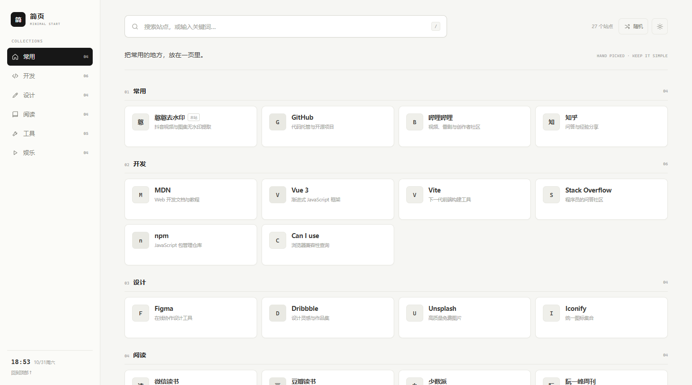
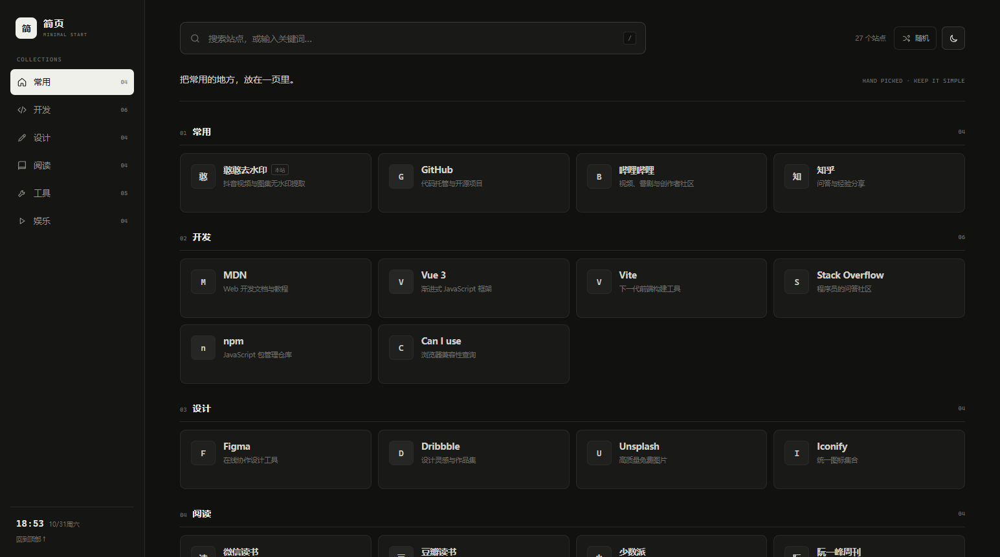
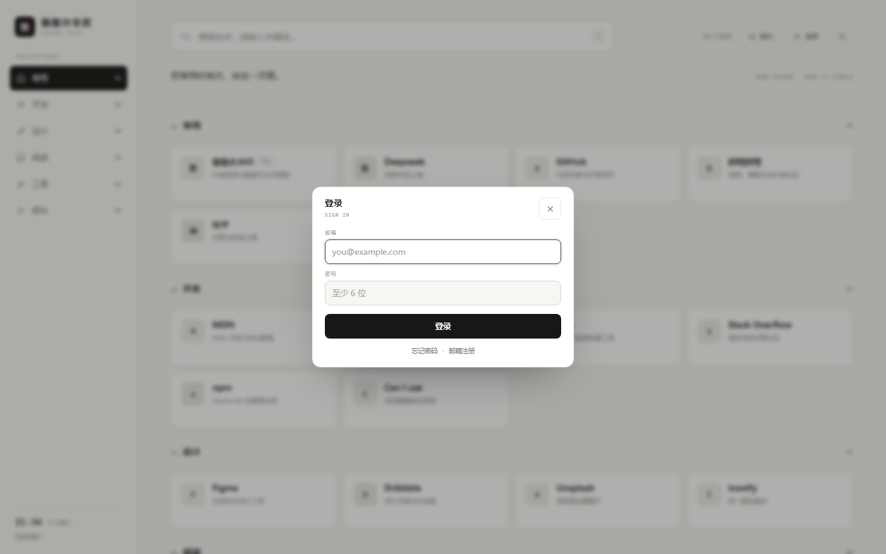

# 简页 · 极简导航

一个极简的个人导航页。左侧分类、顶部搜索、卡片式站点列表，没有多余装饰。







## 特性

- 左侧分类锚点导航，滚动自动高亮
- 顶部实时搜索：按名称、描述、分类、网址筛选
- 搜索空状态、随机打开一个站点
- 明暗主题切换，自动记住选择
- 账号系统：邮箱注册 / 登录 / 忘记密码 / 修改密码 / 退出（Supabase）
- 键盘 `/` 聚焦搜索，`Esc` 清空
- 桌面四列 / 平板三列 / 手机单列
- 纯单文件，无 npm 依赖，无外部图片和字体请求

## 直接使用

双击 `index.html` 即可。

## 账号系统（Supabase）

右上角「登录」打开账号面板，包含：邮箱注册、登录、忘记密码、修改密码、退出登录。
账号存在 Supabase 的 `auth.users` 里，页面只保存登录令牌（localStorage），不存密码。

### 1. 密钥（已配好）

`index.html` 最下面那个 `<script>` 里已经写好了：

```js
const SUPABASE_URL = 'https://uhbpvptqskbcldtnjqpq.supabase.co';
const SUPABASE_KEY = 'sb_publishable_k11E…';   // 公开密钥，可以放前端
```

换项目时改这两行即可。也可以在页面里点「登录」，第一次会弹「连接 Supabase」的输入框，粘进去保存（存在浏览器本地，优先级高于这里的常量）。

> 这个 key 是给浏览器用的公开密钥；**不要**把 `service_role` / `secret key` 或数据库密码放进来。

### 2. 邮箱验证（当前项目是「开启」状态）

这个项目的 `Confirm email` 是开着的，所以注册后 Supabase 会发验证邮件，点完链接才算真正注册成功。两个选择：

- **想省事**：`Authentication → Providers → Email` 里关掉 **Confirm email**，注册完直接登录。
- **想保留验证**：`Authentication → URL Configuration` 把 `Site URL` 改成你实际部署的地址（比如 `https://wnza.github.io/...`），并把同一地址加进 `Redirect URLs`。否则邮件里的链接会跳去默认的 `localhost:3000`，打不开。

本地用 `file://` 双击打开时，验证链接和「忘记密码」的回跳都没法落回页面，这两条流程要在部署后的地址上测；登录、注册请求本身在 `file://` 下是通的（已实测）。

### 3. 邮箱验证 / 重置密码的跳转

验证邮件和重置邮件的链接形如 `你的地址#access_token=...&type=recovery`，页面启动时会自动识别：
- 验证链接 → 直接登录
- 重置链接 → 弹出「设置新密码」，保存后自动登录

### 4. 说明

- 改密码需要先输入当前密码，前端会用它重新登录一次（Supabase 的重新验证），再调用 `PUT /auth/v1/user` 更新。
- 会话令牌过期会自动用 refresh_token 续期，续不上就静默退出。
- 单文件实现，没有引 `supabase-js`，直接调 GoTrue 的 REST 接口，所以断网/被墙时不会卡在 CDN 上。

## 修改站点

打开 `index.html`，在底部脚本里找到 `SITES`：

```js
{ cat: '常用', name: 'GitHub', desc: '代码托管与开源项目', url: 'https://github.com/', mark: 'G' }
```

- `cat`：分类名，需要和 `CATEGORIES` 里的分类对应
- `name`：站点名称
- `desc`：一句话描述
- `url`：点击后打开的地址
- `mark`：卡片左侧的字母 / 汉字标记
- `badge`：可选，例如 `本站`

分类顺序在 `CATEGORIES` 中调整：

```js
{ name: '设计', icon: 'pen', slug: 'design' }
```

`icon` 可用：`home`、`code`、`pen`、`book`、`tool`、`play`。
`slug` 用于生成分类锚点，例如 `#cat-design`。

## 部署到 GitHub Pages

页面是纯静态单文件，放到任意静态目录即可，例如：

- `https://wnza.github.io/vue_study/`
- `https://wnza.github.io/vue_study/minimal-nav/`

里面默认放的是正规常用站点；如果你要换成自己的收藏，直接修改 `SITES` 后重新上传即可。

## 说明

示例站点仅用于展示导航结构，不代表推荐或背书。页面不收集访问数据，主题偏好只保存在浏览器本地。
